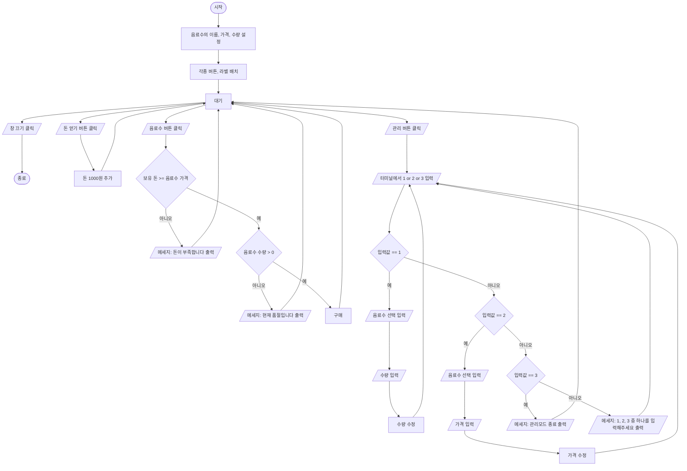

# REPORT

## 파이썬을 활용한 자판기 프로그램 구현
---

## 목차

1. 프로그램 개요 및 순서도
2. 파이썬 소스 코드
3. 코드 설명
   - 3-1. 코드의 작동 모습
4. 과제 수행 소감
5. 부록: 시행착오 & TMI

---

## 1. 프로그램 개요 및 순서도

파이썬 기본 문법과 tkinter 라이브러리를 활용하여 자판기 프로그램을 제작하였습니다.
음료수 선택, 구매, 계산, 재고 관리, 가격 관리 등 여러 가지 기능을 구현하였으며,
외부 라이브러리, 함수 등을 사용하면 더 간편하게 작성이 가능하지만
도전정신을 갖고 강의 시간 중 배운 내용으로만 최대한 구현하는 것을 목표로 했습니다.



*[자판기 프로그램의 순서도]*

자판기 프로그램의 대략적인 작동 과정을 순서도로 나타내었습니다. 이를 바탕으로 프로그램의 코드 작성을 진행하였습니다.

---

## 2. 파이썬 소스 코드

```python
from tkinter import *
from tkinter import messagebox

drink = [["물",800,2],["핫식스",2000,5],["옥수수수염차",1600,0],["트레비",1300,1],
         ["펩시제로콜라",1100,10],["칠성사이다",1300,2],["립톤",1200,3],["레쓰비",900,4]]
choice = None
money = 0

def addmoney():
    global money
    if money >= 10000:
        messagebox.showinfo("SYSTEM", f"너무 많은 욕심은 도리어 화를 불러옵니다..")
    else:
        money += 1000
        moneystate.configure(text=f"현재 돈: {money}")

def removemoney(a):
    global money
    money -= a
    moneystate.configure(text=f"현재 돈: {money}")

def selcet_drink(d):
    global choice
    choice = d
    if drink[choice][2] == 0:
        messagebox.showinfo("SYSTEM", f"현재 {drink[choice][0]}은(는) 품절입니다.")
    else:
        choicestate.configure(text=f"선택: {drink[choice][0]}")
        pricestate.configure(text=f"가격: {drink[choice][1]}원")

def buy():
    try:
        if money >= drink[choice][1]:
            if drink[choice][2] <= 0:
                messagebox.showinfo("SYSTEM", f"현재 {drink[choice][0]}은(는) 품절입니다.")
            else:
                messagebox.showinfo("SYSTEM", f"구매하였습니다.")
                removemoney(drink[choice][1])
                drink[choice][2] -= 1
                amountcheck()
        else:
            messagebox.showinfo("SYSTEM", f"돈이 부족합니다.")
    except:
        messagebox.showinfo("SYSTEM", f"현재 선택된 음료가 없습니다.")

def manage():
    while True:
        a = int(input("관리 항목을 골라주세요.\n1.재고 관리\n2.가격 수정\n3.종료\n"))
        if a == 1:
            print("관리할 제품을 선택해주세요.")
            global drink
            for i in range(0,len(drink)):
                print(f"{i+1}. {drink[i][0]}")
            b = int(input(""))
            c = int(input(f"현재 수량: {drink[b-1][2]}\n제품의 수량을 입력해주세요.\n"))
            drink[b-1][2] = c
            amountcheck()
        elif a == 2:
            print("관리할 제품을 선택해주세요.")
            for i in range(0,len(drink)):
                print(f"{i+1}. {drink[i][0]}")
            b = int(input(""))
            c = int(input(f"현재 가격: {drink[b-1][1]}\n수정할 가격을 입력해주세요.\n"))
            drink[b-1][1] = c
            if choice != None:
                pricestate.configure(text=f"가격: {drink[b-1][1]}원")
        elif a == 3:
            print("관리 모드를 종료합니다.")
            break
        else:
            print("1, 2, 3중 하나를 입력해주세요")

win = Tk()
win.geometry("500x700")
win.title("자판기 프로그램")

d0img = PhotoImage(file = "..\\store\\물.png")
d1img = PhotoImage(file = "..\\store\\핫식스.png")
d2img = PhotoImage(file = "..\\store\\옥수수수염차.png")
d3img = PhotoImage(file = "..\\store\\트레비.png")
d4img = PhotoImage(file = "..\\store\\펩시제로콜라.png")
d5img = PhotoImage(file = "..\\store\\칠성사이다.png")
d6img = PhotoImage(file = "..\\store\\립톤.png")
d7img = PhotoImage(file = "..\\store\\레쓰비.png")

drink0 = Button(win, image=d0img,width=100,height=50,command=lambda: selcet_drink(0))
drink1 = Button(win, image=d1img,width=100,height=50,command=lambda: selcet_drink(1))
drink2 = Button(win, image=d2img,width=100,height=50,command=lambda: selcet_drink(2))
drink3 = Button(win, image=d3img,width=100,height=50,command=lambda: selcet_drink(3))
drink4 = Button(win, image=d4img,width=100,height=50,command=lambda: selcet_drink(4))
drink5 = Button(win, image=d5img,width=100,height=50,command=lambda: selcet_drink(5))
drink6 = Button(win, image=d6img,width=100,height=50,command=lambda: selcet_drink(6))
drink7 = Button(win, image=d7img,width=100,height=50,command=lambda: selcet_drink(7))

mngbtn = Button(win, text="관리",width=10,height=1,bg="white",command=manage)
buybtn = Button(win, text="구매",width=10,height=1,bg="white",command=buy)
addmoneybtn = Button(win, text="돈 얻기",bg="white",command=addmoney)

moneystate = Label(win,text=f"보유 돈: {money}",fg="black",bg="white")
choicestate = Label(win,text=f"선택: -",fg="black",bg="white")
pricestate = Label(win,text=f"가격: -",fg="black",bg="white")

drinkdict = {"drink0":drink0,
             "drink1":drink1,
             "drink2":drink2,
             "drink3":drink3,
             "drink4":drink4,
             "drink5":drink5,
             "drink6":drink6,
             "drink7":drink7,
             }

def amountcheck():
    for i in range(0,len(drink)):
        if drink[i][2] == 0:
            a = "drink" + str(i)
            drinkdict[a].configure(bg="red")
        else:
            a = "drink" + str(i)
            drinkdict[a].configure(bg="lime")

amountcheck()
win.resizable(width=False, height=False)

drink0.pack()
drink1.pack()
drink2.pack()
drink3.pack()
drink4.pack()
drink5.pack()
drink6.pack()
drink7.pack()
choicestate.pack()
pricestate.pack()
buybtn.pack()
mngbtn.pack(side=BOTTOM)
addmoneybtn.pack(side=RIGHT)
moneystate.pack(side=RIGHT)

win.mainloop()
```

---

## 3. 코드 설명

### 3-0. 변수 및 기본 함수

라이브러리를 불러오고 여러 변수에 값을 할당했습니다. `drink` 리스트를 2차원 리스트로 구성하여 각 음료수의 이름, 가격, 수량 정보를 저장했고, 어떤 음료수를 선택했는지 알려주는 `choice` 변수에는 `None`, 보유 돈 `money` 변수에는 `0` 값을 할당했습니다.

프로그램 작동에 필요한 여러 가지 함수를 정의했습니다.

- **`addmoney()`**: '돈 얻기' 버튼을 클릭했을 때 실행되는 함수로, `money` 값에 1000을 더합니다. 이후 `moneystate` 라벨을 수정하여 현재 보유한 돈 값을 출력합니다. 이스터에그로 조건문을 활용하여, 보유한 돈이 10000원 이상(`money` 값이 10000 이상)인 경우 경고 메세지를 띄우며 돈을 얻을 수 없도록 하였습니다.
- **`removemoney(a)`**: 보유 돈 `money` 값에서 음료 값 `a`를 빼고, `moneystate` 라벨을 수정하여 현재 보유한 돈 값을 출력합니다.
- **`select_drink(d)`**: 자판기에서 `d`번 음료를 선택했을 때 `choice` 값을 `d`로 할당하고, 음료의 수량에 따라 선택 여부를 결정합니다. 조건문을 통해 선택한 음료의 수량이 0 이상일 경우 `choicestate`, `pricestate` 라벨을 수정하여 선택한 음료의 이름과 가격을 출력합니다.

### 3-0-1. `buy()` 함수

`buy()` 함수는 구매 버튼을 클릭했을 때 실행되는 함수입니다. 조건문을 사용하여 보유한 돈(`money`)이 선택한 음료수의 가격(`drink[choice][1]`)보다 크고, 선택한 음료수의 수량(`drink[choice][2]`)이 0 이하가 아닐 경우 음료수를 구매합니다. `removemoney()` 함수를 사용하여 `money`에서 음료수의 가격만큼을 빼고 해당 음료수의 수량에서 1을 뺍니다. 이후 후술할 `amountcheck()` 함수를 사용합니다. 만약 수량이 0 이하일 경우, 돈이 부족할 경우 메세지를 띄우며 구매를 제한합니다. 음료수를 선택하지 않은 상태(`choice`가 `None`인 상태)에서 구매 버튼을 누르면 `drink` 리스트의 값을 호출하는 과정에서 에러가 발생하므로 `try`, `except`를 활용하여 예외 처리하였습니다.

### 3-0-2. `manage()` 함수

`manage()` 함수는 관리 버튼을 클릭했을 때 실행되는 함수입니다. `while` 반복문을 사용하여 여러 번 작동할 수 있도록 하였습니다. 재고 관리, 가격 수정, 종료 3가지 기능이 있으며 1, 2, 3 중 하나의 값을 입력받아 기능을 선택합니다.

- **입력값이 1일 경우**: 선택한 음료수 번호(0~7번 음료수 중 `b-1`번 음료수)의 수량을 원하는 값(`c`)으로 수정합니다. 이후 후술할 `amountcheck()` 함수를 사용합니다.
- **입력값이 2일 경우**: 선택한 음료수의 가격을 원하는 값 `c`로 수정합니다. 만약 현재 자판기 상에서 선택한 음료수가 있다면(`choice` 값이 `None`이 아니라면) `pricestate` 라벨을 수정하여 선택한 음료수의 바뀐 가격을 출력합니다.
- **입력값이 1 또는 2일 경우 공통**: `for`문을 통해 모든 음료수를 출력합니다. 이때 1~8번까지의 보기를 띄워 사용자는 1~8 중 하나의 값을 입력하도록 합니다.
- **입력값이 3일 경우**: 관리 모드를 종료하며 `while` 반복문을 `break`를 통해 탈출합니다.
- **그 외의 값**: 1, 2, 3이 아닌 다른 값이 입력될 경우 메세지와 함께 값을 다시 입력하도록 합니다.

### 3-0-3. tkinter 창 구성

`tkinter` 라이브러리를 활용하여 창을 만들고 이미지, 버튼, 라벨 등을 생성합니다. 폴더의 위치가 바뀌어도 원활히 실행할 수 있도록 이미지를 상대경로로 불러왔습니다.

`drinkN` 버튼을 클릭하면 `select_drink(N)` 함수가 실행되고, 관리(`mngbtn`), 구매(`buybtn`), 돈 얻기(`addmoneybtn`)를 클릭할 경우 각각 `manage`, `buy`, `addmoney` 함수가 실행됩니다. `moneystate`, `choicestate`, `pricestate` 라벨을 통해 화면에 보유 돈, 선택한 음료수, 음료수의 가격을 표시합니다.

### 3-0-4. `drinkdict`와 `amountcheck()`

`drinkdict` 변수에 딕셔너리를 선언합니다. 딕셔너리에는 문자열 `"drinkN"` 키에 대하여 tkinter `drinkN` 버튼을 값으로 할당했습니다. 이후 `amountcheck()` 함수를 정의합니다. 해당 함수는 음료수의 수량을 체크하여 음료수 버튼의 배경색을 결정합니다. `for` 반복문을 통해 음료수의 개수만큼 구문을 반복하며, 만약 `i`번 음료수(0~7번 음료수 중 하나)의 수량이 0일 경우 해당 버튼의 배경색을 빨간색으로 변경합니다. 문자열 더하기와 딕셔너리를 활용하여 문자열 값을 버튼이 할당된 변수로 변경하여 `configure` 메소드가 잘 작동하도록 했습니다.

### 3-0-5. 실행부

프로그램을 처음 실행할 때 `amountcheck()` 함수를 한 번 실행하여 음료수 버튼의 배경색을 결정하고, 프로그램의 창 조절을 불가하게 했습니다. `pack()` 메소드를 통해 각종 버튼과 라벨을 배치하고, `mainloop()` 메소드를 통해 실행된 창을 유지합니다.

---

## 3-1. 코드의 작동 모습

### ① 초기 화면

> 📷 *(스크린샷: 프로그램 초기 실행 화면)*

프로그램을 처음 실행하면 보이는 화면입니다. 옥수수수염차(3번째 음료수)의 수량이 0이므로 `amountcheck()` 함수에 의해 버튼의 배경색이 빨강으로 설정되었습니다. 그 외의 경우 수량이 0 초과이므로 배경색이 초록색입니다.

### ② 음료수 선택 및 돈 부족

> 📷 *(스크린샷: 립톤 선택, 현재 돈 1000원 상태)*

임의의 음료수 버튼을 눌렀을 때 나타나는 화면입니다. 화면은 립톤(6번째)을 선택하였을 때이며, 선택한 음료와 가격을 라벨을 통해 표시합니다. 또한 돈 얻기 버튼을 눌러 1000원을 얻었습니다. 지금 상태에서 구매 버튼을 누를 경우 200원이 부족하므로 다음과 같은 메세지 팝업이 나타납니다.

> 📷 *(스크린샷: "돈이 부족합니다." 팝업)*

### ③ 구매 성공 및 품절

> 📷 *(스크린샷: "구매하였습니다." 팝업, 현재 돈 2000원)*

돈 얻기 버튼을 한 번 더 클릭하여 현재 돈을 2000원으로 만들고, 다시 구매 버튼을 클릭하면 다음과 같이 메세지 팝업이 뜨며 구매가 가능합니다.

> 📷 *(스크린샷: "현재 옥수수수염차(은)는 품절입니다." 팝업, 현재 돈 800원)*

1200원의 립톤을 구매하였으므로 현재 돈 2000에서 1200이 차감되어 800이 남은 모습입니다. 또한 재고가 없는 옥수수수염차를 클릭할 경우 위와 같은 메세지 팝업이 뜹니다.

### ④ 관리 모드

```text
PS C:\Users\jungj\Desktop\store> & C:/Python314/python.exe c:/Users/jungj/Desktop/store/store.py
관리 항목을 골라주세요.
1.재고 관리
2.가격 수정
3.종료
```

관리 버튼을 클릭할 경우 터미널에 위와 같은 메세지가 출력됩니다.

```text
1
관리할 제품을 선택해주세요.
1. 물
2. 핫식스
3. 옥수수수염차
4. 트레비
5. 펩시제로콜라
6. 칠성사이다
7. 립톤
8. 레쓰비
```

1을 입력한 경우 위와 같은 메세지가 출력됩니다. 1~8번 중 하나를 입력하여 관리할 음료수를 선택할 수 있습니다. 코드에서는 입력값에서 1을 뺀 값으로 선택이 이루어집니다.

```text
3
현재 수량: 0
제품의 수량을 입력해주세요.
3
관리 항목을 골라주세요.
1.재고 관리
2.가격 수정
3.종료
```

3을 입력하여 옥수수수염차를 선택했습니다. 현재 수량도 출력해주며 이후 값을 입력하여 수량을 결정할 수 있습니다. 3을 입력하여 옥수수수염차의 수량을 3개로 결정했고, 반복문에 의해 다시 관리 항목을 고르도록 메세지가 출력되었습니다.

```text
3
관리 모드를 종료합니다.
```

> 📷 *(스크린샷: 모든 버튼이 초록색으로 바뀐 화면)*

3을 입력하여 관리 모드를 종료하였고, 옥수수수염차의 수량이 3이 되었으므로 해당 버튼의 배경색도 초록으로 바뀌었습니다.

---

## 4. 과제 수행 소감

평소 파이썬 프로그래밍을 취미로 하고 있어서 이번 자판기 프로그램 과제도 어렵지 않게 진행할 수 있을거라 판단했습니다. 그러나 프로그램 작성 중 예상치 못한 부분에서 어려움을 겪었습니다. 여러 시행착오를 겪으며 결국에는 프로그램을 완성시켰고, 성취감과 뿌듯함을 느꼈습니다. 또한 프로그래밍 작성에 대해 어떤 점들을 고려해야하는지 다시금 익힐 수 있었습니다. 이번 과제는 파이썬프로그래밍 강의시간에 배웠던 부분만을 활용하여 진행했습니다. 나름 스스로 제한을 걸어 코딩을 해보니 재밌었고, 결과물을 도출했을 때 성취감을 느꼈습니다.

---

## 5. 부록: 시행착오 & TMI

이번 과제를 수행하며 겪었던 시행착오, 여러 자잘한 얘기들을 풀어보고자 합니다 ㅎㅎ..

### 5-1. class 대신 2차원 리스트

처음 과제를 시작할 당시 `class`를 활용하여 음료수들의 값을 저장, 활용하고자 하였습니다.

```python
class Drink():
    name = ""
    price = 0
    amount = 0
```

`class`를 활용하여 값을 저장하는 것까지는 잘 진행했지만, 저장된 음료수의 값을 불러와 활용할 방법, `tkinter`와의 연동 방법 등을 마땅히 찾지 못하여 결국 2차원 리스트로 방향을 바꾸었습니다.

### 5-2. 어느 버튼을 눌렀는지 전달하기 (`lambda`)

특정 음료수 버튼을 클릭했을 때 어느 버튼을 클릭했는지 정보를 전달할 방법을 고민했습니다. 처음에는 각 버튼에 대한 함수를 8개 만들어서 버튼마다 할당해주어야하나 했지만, 코드의 길이가 길어지고 비효율적이라 생각되어 다른 방법을 모색하였습니다. 다행히 현재의 `select_drink(n)` 함수를 생각해내어 1개의 함수로 몇 번 드링크의 버튼이 눌렸는지 정보를 전달할 수 있도록 했습니다.

그러나 아래와 같이 코드를 작성했을 때, 프로그램을 실행하고 `tkinter` 창이 열리자마자 바로 버튼의 함수가 실행되는 문제가 생겼습니다.

```python
drink0 = Button(win, image=d0img,width=100,height=50,command=select_drink(0))
drink1 = Button(win, image=d1img,width=100,height=50,command=select_drink(1))
drink2 = Button(win, image=d2img,width=100,height=50,command=select_drink(2))
```

찾아보니 `command=함수명()`으로 기재하면 프로그램 실행과 동시에 함수가 실행되고, `command=함수명`으로 기재해야 버튼을 눌렀을 때 함수가 실행되는 것이었습니다. 그러나 이렇게 되면 `select_drink(n)` 함수에 숫자 `n`을 할당할 수 없고, 어느 버튼을 클릭했는지 알릴 수 없습니다.

다행히 `lambda`를 활용하여 작은 함수를 정의하였고, 버튼을 클릭했을 때만 함수가 실행되도록 할 수 있었습니다.

```python
drink0 = Button(win, image=d0img,width=100,height=50,command=lambda: select_drink(0))
```

### 5-3. `amountcheck()`와 딕셔너리

`amountcheck()` 함수를 만들 때 여러 시행착오가 있었습니다. 음료수들의 수량을 확인해서 버튼 배경색의 여부(초록색 or 빨간색)를 결정해야하는데, `for`문을 활용해서 수량은 확인할 수 있지만 `tkinter`의 `configure` 메소드를 사용할 수 없었습니다. 위 코드 상에서 `a` 값은 문자열이고, `.configure` 메소드는 변수명에 사용하는 것이기 때문입니다. `eval()` 함수를 통해 `eval(a).configure`와 같이 사용하여 해결할 수 있지만, 강의시간에 배운 내용으로만 과제를 수행하고 싶었습니다. 그래서 딕셔너리를 활용하여 문자열 키에 변수명을 값으로 할당하여, 문자열을 변수명으로 변환하여 사용, 문제를 해결할 수 있었습니다.

```python
drinkL = {"drink0":drink0,
          "drink1":drink1,
          "drink2":drink2,
          "drink3":drink3,
          "drink4":drink4,
          "drink5":drink5,
          "drink6":drink6,
          "drink7":drink7,
          }

def amountcheck():
    for i in range(0,len(drink)):
        if drink[i][2] == 0:
            a = "drink" + str(i)
            drinkL[a].configure(bg="red")
        else:
            a = "drink" + str(i)
            drinkL[a].configure(bg="lime")
```

### 5-4. 구현하지 못한 기능: 상태 저장 / 불러오기

원래는 관리 모드에서 3, 4를 입력할 경우 자판기 상태 저장, 자판기 상태 불러오기를 할 수 있는 기능을 구현하려했습니다. 관리 모드에서 수정된 음료수의 수량, 가격을 저장하고 그것을 불러와서 적용하도록 하고 싶었지만, 첫번째 코드의 경우 값을 불러올 때 모든 값들에 `\n`이 붙은 문자열 값으로 불러와져 정상적인 활용이 어려웠습니다. 두번째 코드는 리스트 통째로 문자열 값으로 불러와져 이를 활용이 어려웠습니다. 첫번째 코드는 `strip()` 메소드, 두번째는 `eval()` 메소드를 통해 해결이 가능하지만 강의내용 밖의 부분이고, 강의시간에 배운 내용으로만 과제를 수행하고 싶어 다른 방안을 찾아보게 되었습니다. 결국 시간상의 문제로 해당 기능을 제외하게 되었습니다.

**첫 번째 시도 (값 하나씩 저장)**

```python
elif a == 3:
    statefile = open("..\\store\\state.txt","w")
    for i in range(0,len(drink)):
        for j in range(0,3):
            statefile.write(str(drink[i][j])+"\n")
    statefile.close()
    print("상태를 저장했습니다.")
elif a == 4:
    statefile = open("..\\store\\state.txt","r")
    for i in range(0,len(drink)):
        for j in range(0,3):
            drink[i][j]= statefile.readline()
            print(drink[i][j])
    print(drink)
```

**두 번째 시도 (리스트 통째로 저장)**

```python
elif a == 3:
    statefile = open("..\\store\\state.txt","w")
    for i in range(0,len(drink)-1):
        drink[i] = str(drink[i])
        statefile.write(drink[i]+",")
    drink[len(drink)-1] = str(drink[len(drink)-1])
    statefile.write(drink[len(drink)-1])
    statefile.close()
    print("상태를 저장했습니다.")
elif a == 4:
    statefile = open("..\\store\\state.txt","r")
    drink = statefile.readlines()
    print(drink)
```
